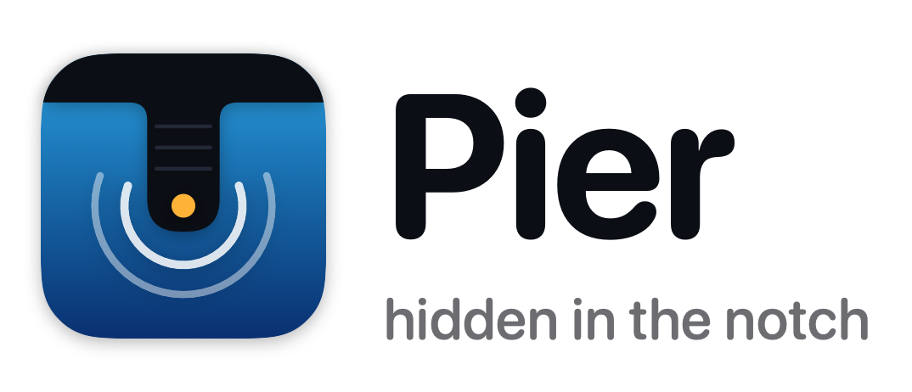
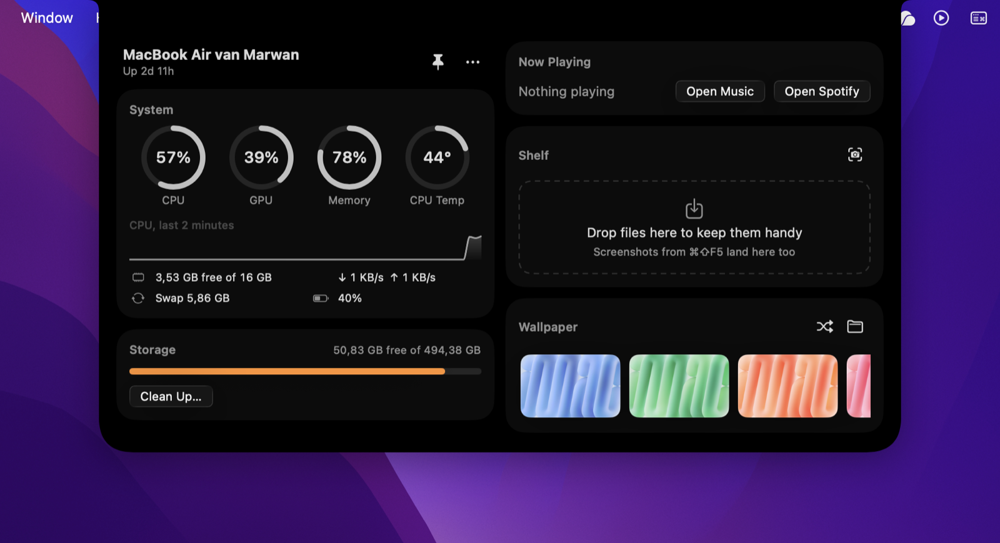
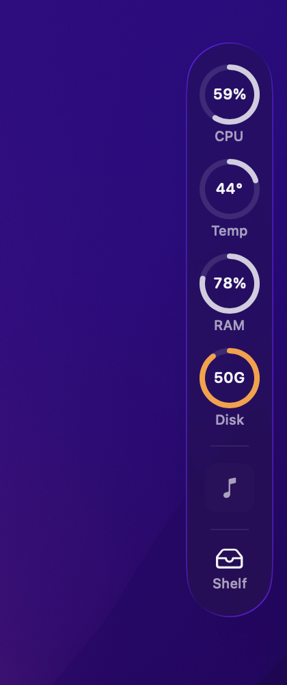
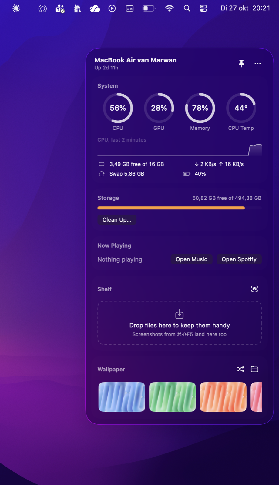

<h1 align="center">
  <picture>
    <source media="(prefers-color-scheme: dark)" srcset="docs/brand/logo-dark.png">
    
  </picture>
</h1>

<p align="center"><strong>Your Mac's vitals, music, files, and wallpaper, hidden in the notch.</strong></p>

Pier is a small native macOS app that lives in the MacBook notch. Nothing shows until you
move the pointer to the notch; then a panel drops out of it with live system stats, storage
cleanup, music controls, a shelf for stashing files and screenshots, and one-click wallpapers.
Prefer it always visible? Pin it to the left or right edge of the screen as a slim Liquid
Glass strip instead.

<p align="center">
  
</p>

<p align="center">
  
  &nbsp;&nbsp;
  
</p>

## Features

- **Hidden in the notch.** Closed, Pier is exactly the size of the notch, so you see nothing.
  Hover the notch, or drag a file onto it, and the panel grows out of it. On displays without a
  notch, the same invisible hover target sits in the middle of the menu bar.
- **Live beside the notch.** While music plays, the notch grows a little to each side, showing the
  album art on the left and a moving waveform on the right, like the Dynamic Island. Pin any
  reading (CPU, GPU, temperature, memory, free disk space, battery) and it stays visible next to
  the notch even while Pier is closed.

  
- **Or on a screen edge.** A Liquid Glass strip with CPU load, CPU temperature, memory, and free
  disk space that's always in view and opens into the full panel on hover.
- **System.** CPU, GPU, memory, and CPU die temperature gauges, a 2-minute CPU history, free
  memory, swap, network speed, and battery. Readings turn orange or red when they run high, and
  always show the number too.
- **Storage cleanup.** Scans app caches, logs, Xcode DerivedData, the npm cache, old installers
  in Downloads, and the Trash, and shows how much each would free. Nothing is removed until you
  review the list and press **Clean**. Old installers go to the Trash so you can get them back,
  and emptying the Trash is off by default and warns you first.
- **Now Playing.** Artwork, progress, and play/pause/next/previous for Apple Music and Spotify.
- **Shelf.** Drop files, photos, or images from a browser to stash them, then drag them out where
  you need them. **⌘⇧F5** takes a screenshot of a region (press Space for a window) straight
  onto the shelf.
- **Wallpaper.** Change it in one click from the macOS set or a folder of your own, or shuffle.
- Light and dark mode, VoiceOver labels on every control, and Reduce Motion support.

## Requirements

- macOS 26 (Tahoe) or later
- Xcode 26 or later, to build it
- Apple silicon for the CPU temperature reading. Everything else works on any Mac that runs
  macOS 26.

## Install

Pier isn't on the App Store, so you build it from source. It takes about a minute.

```bash
git clone https://github.com/MarwanF611/pier.git
cd pier
./build.sh --install
```

That builds `Pier.app`, copies it to `/Applications`, and launches it. Move the pointer to the
notch to open it.

To start Pier automatically when you log in, choose **Open at Login** from Pier's **…** menu,
or run:

```bash
/Applications/Pier.app/Contents/MacOS/Pier --open-at-login
```

To build without installing, run `./build.sh`; the app lands in `build/Pier.app`.

### Permissions

macOS asks for these the first time a feature needs them:

| Permission | When | Why |
| --- | --- | --- |
| Automation: Music, Spotify | Something is playing | To show the track and control playback |
| Screen Recording | First ⌘⇧F5 screenshot | To capture the region you select |

If you decline one, the feature turns off and the others keep working. Because a locally built
app is signed ad hoc, macOS may ask again after you rebuild.

## Using Pier

| To | Do this |
| --- | --- |
| Open the panel | Hover the notch (or the edge strip) |
| Keep it open | Click the pin in the panel's header |
| Show a reading beside the notch | Hover a gauge and click its pin, or **…** › Show Beside Notch |
| Hide the music beside the notch | **…** › Show Beside Notch › turn off Now Playing |
| Move it | **…** › Position › Hidden in Notch, Left Edge, or Right Edge |
| Open on click instead of hover | **…** › turn off Open on Hover |
| Stash a file | Drag it onto the notch or the strip |
| Take a screenshot to the shelf | **⌘⇧F5**, or the camera button on the shelf |
| Hide or quit Pier | The dock icon in the menu bar |

On a MacBook keyboard F5 is the dictation key by default, so press **fn ⌘⇧F5** unless you've
turned on "Use F1, F2, etc. keys as standard function keys".

## Privacy

Pier runs entirely on your Mac. It has no account, analytics, or telemetry, and it makes one
kind of network request: downloading the cover art Spotify reports for the current track, over
HTTPS. Shelf screenshots and dropped images are stored in
`~/Library/Application Support/Pier/Shelf`; files you drop from Finder stay where they are, and
the shelf only points to them.

## How it works

Pier is SwiftUI on an `NSPanel` that floats above other windows without taking focus. A timer
checks the pointer position so the panel can open from the notch or edge while letting clicks
pass through everywhere else.

| Feature | Source |
| --- | --- |
| CPU and memory | Mach host statistics (`host_processor_info`, `host_statistics64`) |
| GPU | `IOAccelerator` performance statistics in the I/O Registry |
| CPU temperature | Apple silicon die sensors (`PMU tdie*`) via the IOHID event system, in a small C target |
| Network, battery, disk | `getifaddrs`, IOKit power sources, volume resource values |
| Music | AppleScript to Music and Spotify, only when they're already running |
| Screenshot shortcut | A Carbon hot key, which needs no Accessibility permission, and `screencapture -i` |
| Notch geometry | `NSScreen.safeAreaInsets` and `auxiliaryTopLeftArea` / `auxiliaryTopRightArea` |

```
Sources/CSensors/       C shim over the IOHID temperature sensors
Sources/Pier/App/       entry point, menu bar item, panel controller
Sources/Pier/Models/    app and dock state
Sources/Pier/Services/  system stats, music, wallpaper, cleanup, shelf, hot key
Sources/Pier/Views/     SwiftUI views, including the notch shape
```

`Pier --sensors` prints every temperature sensor your Mac exposes, which helps when adding
support for a new chip.

## Brand

The mark is a pier seen from above: a deck running from the shore into the water, which is
also the shape of the notch Pier lives in. The lantern at its tip doubles as the camera.

| Asset | File |
| --- | --- |
| App icon (Icon Composer, Liquid Glass) | [`Resources/AppIcon.icon`](Resources/AppIcon.icon) |
| Icon, flat | [`pier-icon.svg`](docs/brand/pier-icon.svg), [`pier-icon.png`](docs/brand/pier-icon.png) |
| Menu bar glyph | [`pier-menubar.svg`](docs/brand/pier-menubar.svg) |
| Logo | [`logo-light.png`](docs/brand/logo-light.png), [`logo-dark.png`](docs/brand/logo-dark.png) |
| Social images | [`social-preview.png`](docs/brand/social-preview.png) (1280×640), [`linkedin.png`](docs/brand/linkedin.png) (1200×627 @2x) |

Every asset comes from one script: `swift scripts/brand/make-brand.swift`.

## Contributing

Issues and pull requests are welcome. Run `./build.sh` before opening a pull request.

## License

[MIT](LICENSE) © 2026 Marwan Fikri
